# Code Escape Master

> **Run the trail. Master the code.**
>
> A coding adventure where JavaScript fundamentals meet an illustrated expedition through five wild worlds. Read the mission, reason about the code, choose the missing piece, and earn the next step.

[](https://code-escape-master.vercel.app/)
[](https://nextjs.org/)
[](https://react.dev/)
[](https://www.typescriptlang.org/)
[](https://supabase.com/)

<p align="center">
  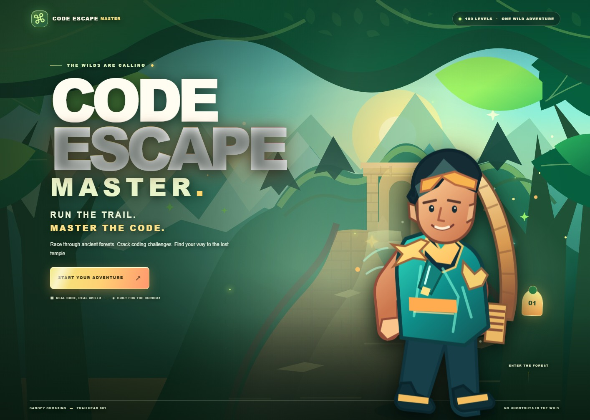
</p>

## The idea

Learning to code is more rewarding when every concept has a purpose. **Code Escape Master** turns bite-sized JavaScript practice into a forest expedition: a field captain sets the scene, a small code puzzle presents a decision, and a correct answer moves the explorer along a 100-level trail.

The experience is designed around three principles:

- **Learn by reasoning:** Read a short, contextualized code snippet and choose the missing expression or line.
- **Make progress feel visible:** Worlds, trail markers, XP ranks, coins, hearts, a daily streak, and achievements all respond to play.
- **Make the interface part of the adventure:** Original forest illustrations, an expedition guide, responsive layouts, optional spoken briefings, and reward moments make the game feel like more than a quiz form.

<p align="center">
  
  &nbsp;&nbsp;&nbsp;
  
</p>

## Inside the game

These are screenshots of the **running application**, captured from a clean local demo profile at desktop and phone-sized viewports. The leaderboard is explicitly in sample-preview mode; no account or player data is shown.

<table>
  <tr>
    <td width="50%">
      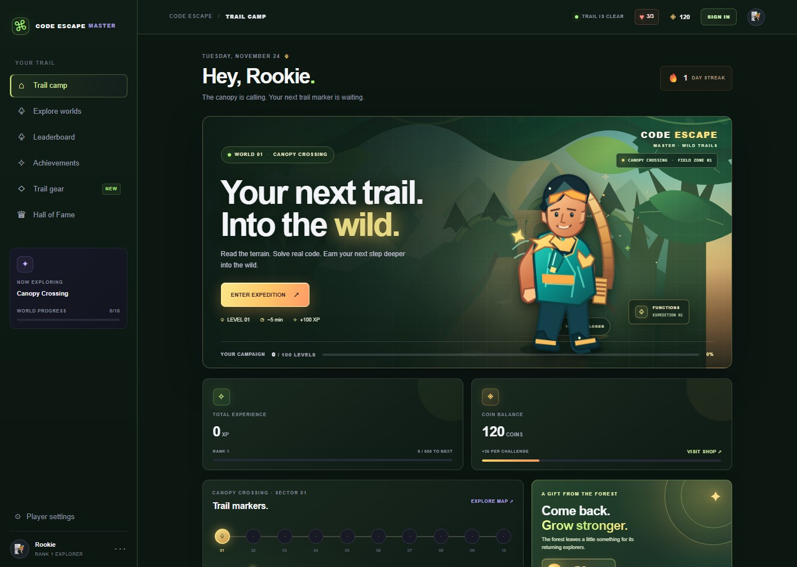
      <p align="center"><strong>Trail Camp</strong> — campaign progress, XP, coins, hearts, and daily rewards.</p>
    </td>
    <td width="50%">
      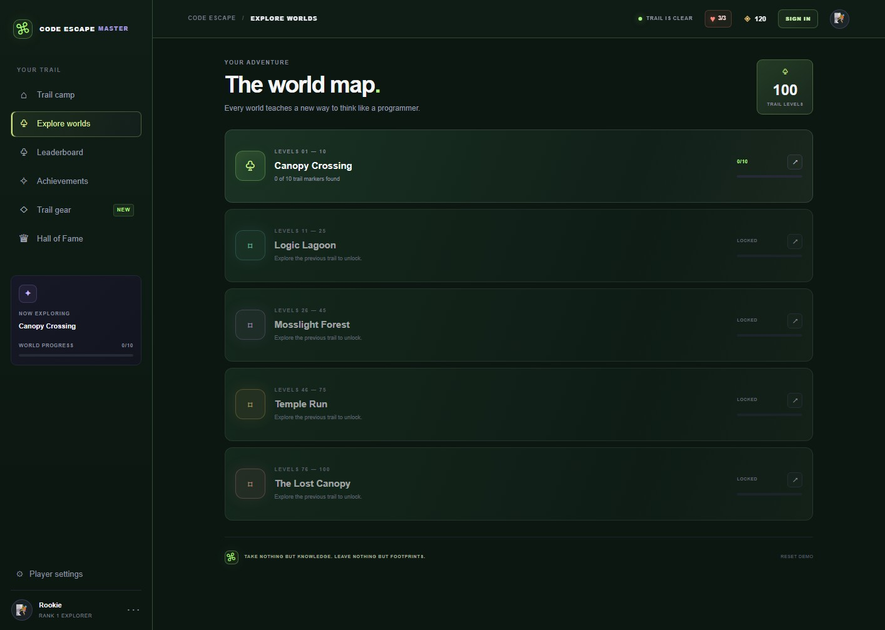
      <p align="center"><strong>The world map</strong> — five regions across the 100-level trail.</p>
    </td>
  </tr>
  <tr>
    <td width="50%">
      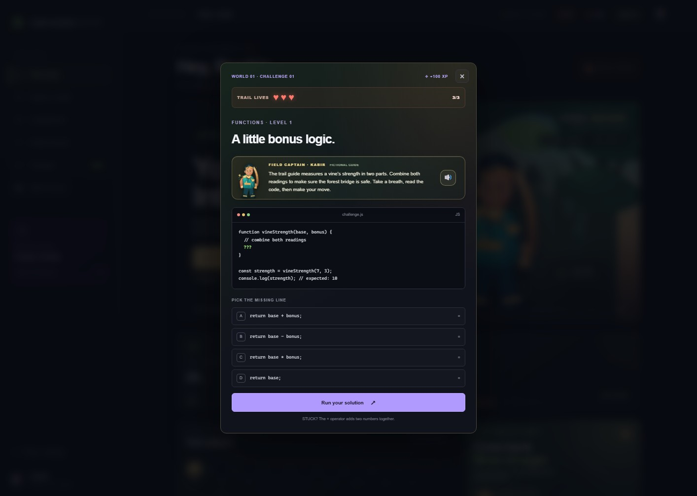
      <p align="center"><strong>A coding challenge</strong> — read the code, choose the missing line, and run your answer.</p>
    </td>
    <td width="50%">
      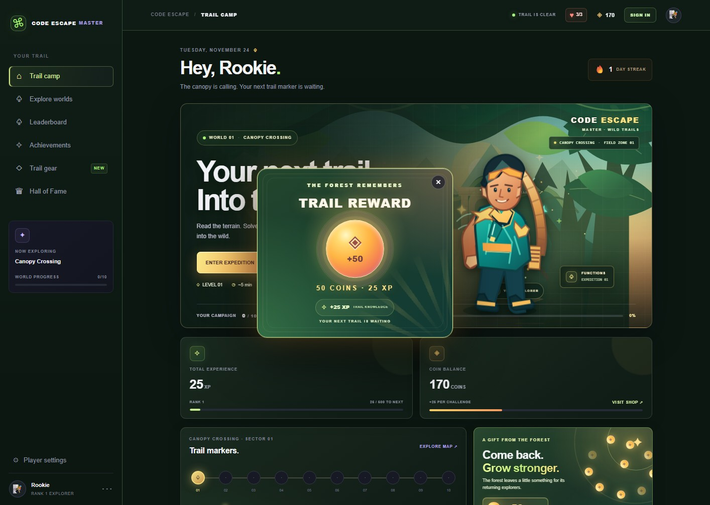
      <p align="center"><strong>Daily reward</strong> — a forest gift of 50 coins and 25 XP.</p>
    </td>
  </tr>
  <tr>
    <td width="50%">
      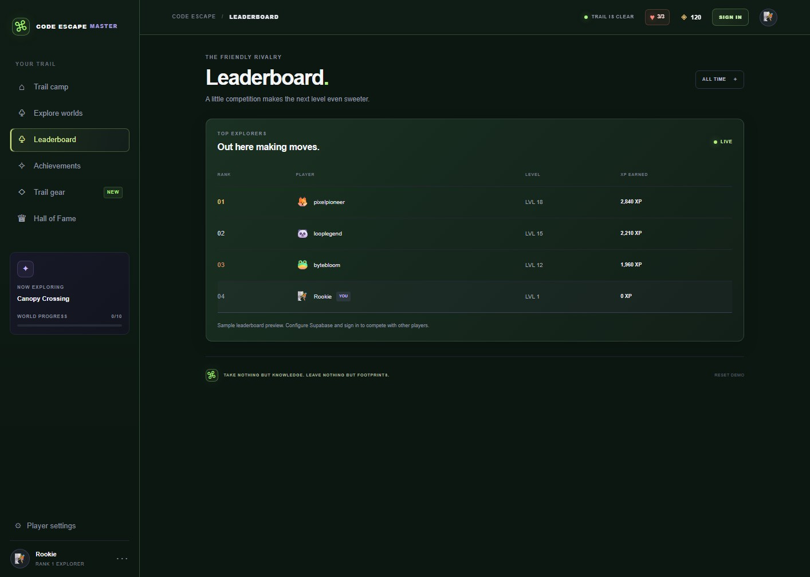
      <p align="center"><strong>Leaderboard</strong> — a sample preview locally; live profile rankings require Supabase.</p>
    </td>
    <td width="50%">
      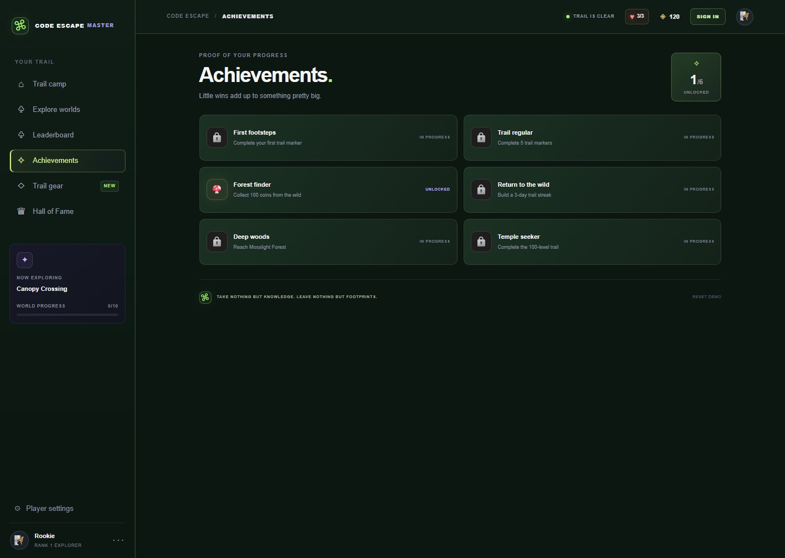
      <p align="center"><strong>Achievements</strong> — milestones for learning, returning, and exploring farther.</p>
    </td>
  </tr>
  <tr>
    <td width="50%">
      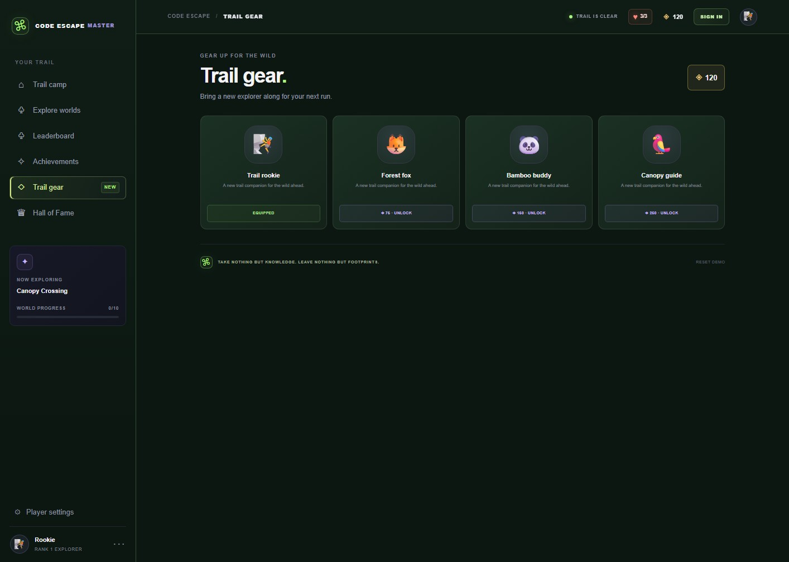
      <p align="center"><strong>Trail gear</strong> — unlock an explorer look with earned coins.</p>
    </td>
    <td width="50%">
      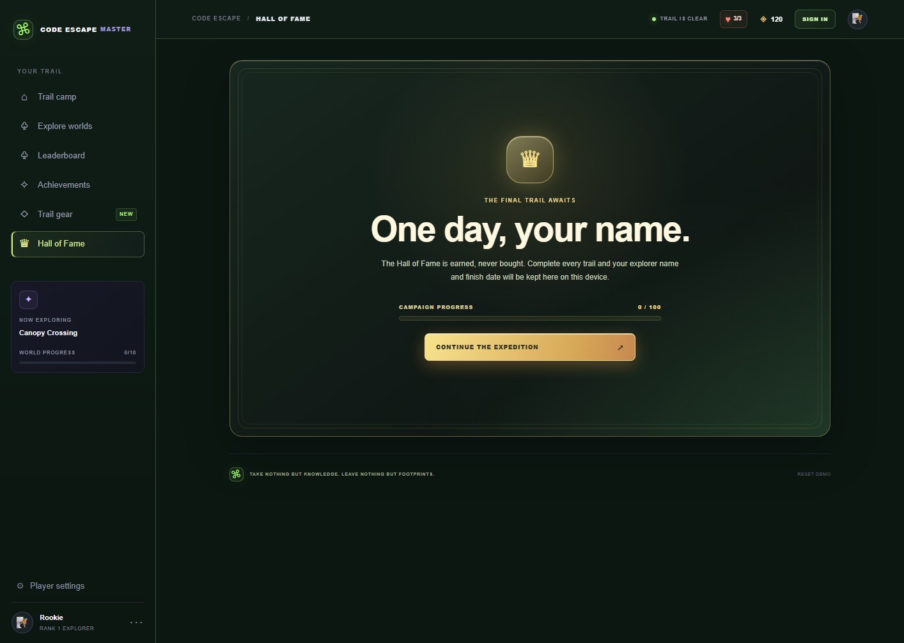
      <p align="center"><strong>Hall of Fame</strong> — complete all 100 campaign levels to earn the finisher entry.</p>
    </td>
  </tr>
</table>

### Made for a phone, too

<p align="center">
  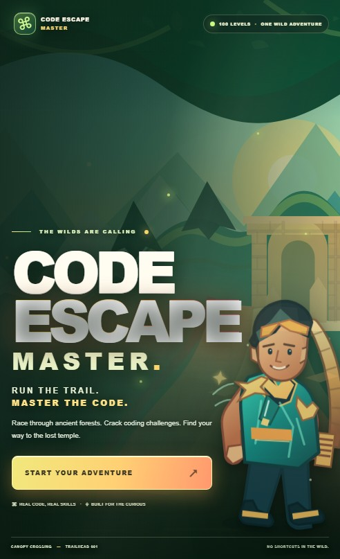
  &nbsp;
  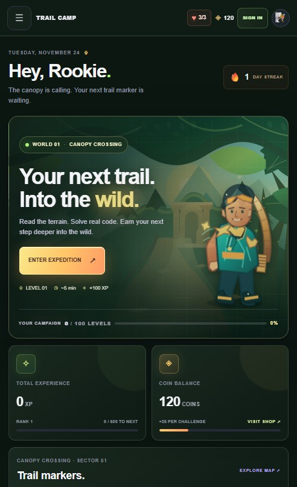
  &nbsp;
  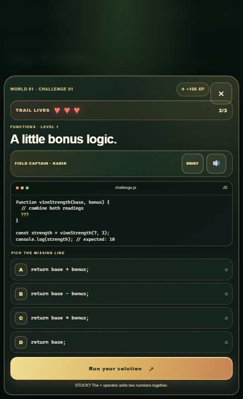
</p>

## Play the game

**Live site:** [code-escape-master.vercel.app](https://code-escape-master.vercel.app/)

The game opens with an adventure intro. When cloud authentication is configured, players sign in with Google or request an email magic link **before** choosing an explorer name. A returning player loads their profile; a new player chooses a name and then enters the game. With no Supabase credentials, the app runs as a local demo and saves progress in that browser.

### A run, from trailhead to finish

1. **Enter the expedition.** Start from the illustrated intro and continue to Trail Camp.
2. **Choose a trail marker.** The current campaign level is unlocked. Completed levels can be replayed for practice; later levels stay locked until the campaign advances.
3. **Read the briefing.** Fictional field captain Kabir explains the programming task. On supported browsers, the briefing can also be read aloud.
4. **Inspect the JavaScript.** Find the `???` in the code window and choose one of four possible completions.
5. **Run your answer.** A correct first attempt on the current campaign level awards **100 XP** and **25 coins**, then marks that level complete. An incorrect answer costs **one heart** and reveals a focused hint. Replaying a completed level is practice and does not award campaign rewards again.
6. **Keep exploring.** The map unlocks the next level. Earn daily rewards, build a streak, browse achievements, customize an explorer avatar, and see the Hall of Fame milestone.

## Campaign map

The 100 trail levels are grouped into five themed worlds:

| World | Levels | Trail markers |
|---|---:|---:|
| **Canopy Crossing** | 1–10 | 10 |
| **Logic Lagoon** | 11–25 | 15 |
| **Mosslight Forest** | 26–45 | 20 |
| **Temple Run** | 46–75 | 30 |
| **The Lost Canopy** | 76–100 | 25 |

Finish a level to advance the campaign by one marker. The map shows completed, current, and locked markers, while each world card tracks progress through that world's levels. The final milestone is completing all **100 campaign levels**.

### What the puzzles teach

The game currently contains **20 authored JavaScript multiple-choice challenges**. The campaign selects a challenge by cycling through those 20 challenges for its 100 levels. The level number and world progression continue; the current challenge set is a focused starter curriculum, **not 100 unique puzzles or a 4,000-question bank**.

| Challenge levels | Topic | Example concept |
|---|---|---|
| 1, 10 | Functions | Return values, combining inputs, accumulating a total |
| 2, 15 | Strings | Concatenation, punctuation, and template literals |
| 3 | Arithmetic | Squaring a value |
| 4, 11, 12 | Arrays | Zero-based indexing, finding a maximum, filtering |
| 5, 13 | Conditionals and loops | Inclusive comparisons and loop boundaries |
| 6, 17 | Boolean logic | Modulo and logical AND |
| 7 | Loops | Counting with an accumulator |
| 8, 14 | Objects | Dot notation and variable-key bracket notation |
| 9, 16 | Array methods | `length` and `find` |
| 18 | Arrow functions | Transforming a value |
| 19 | Sets | Keeping unique values |
| 20 | Error handling | Handling an exception with `catch` |

The challenges ask players to reason about code; they do not execute arbitrary code submitted by a player. Each challenge includes a mission, a code example, four answer choices, and a contextual hint.

## Game rules and rewards

### Hearts and retries

- Every player starts with **3 hearts**.
- Each incorrect submitted answer costs **1 heart**. Choosing an answer is free; the heart is lost when the wrong answer is submitted.
- When all hearts are gone, either spend **50 coins** to refill to 3 hearts or wait for automatic recovery.
- Automatic recovery restores **1 heart every 10 minutes**, up to the 3-heart maximum.
- Correct answers do not consume hearts. A correct campaign answer can be followed by the next unlocked challenge.

### XP and explorer rank

- Completing a new campaign level correctly earns **100 XP**.
- Claiming the daily reward earns an additional **25 XP**.
- Explorer rank is calculated as `floor(total XP / 500) + 1`; each 500 XP advances the rank.
- XP is the leaderboard's primary sort, with completed campaign levels used as a tie-breaker.

### Coins

- New demo profiles begin with **120 coins**.
- Completing a new campaign level correctly earns **25 coins**.
- A daily reward grants **50 coins**.
- The shop offers four avatar choices: Trail rookie (**free**), Forest fox (**75 coins**), Bamboo buddy (**150 coins**), and Canopy guide (**250 coins**).
- A heart refill costs **50 coins**. Avatar purchases change the equipped avatar; they do not change challenge difficulty or grant gameplay advantages.
- The current coin system has no ads-for-coins, paid currency, trading, or item inventory.

### Daily bonus and streak

Claim the forest's daily drop from Trail Camp to receive **50 coins + 25 XP**, once per calendar day. Consecutive daily claims increase the streak by one. If a day is missed, a new claim begins the streak again at one. The daily claim date and streak are part of the saved player profile.

### Achievements

Achievements are progress milestones, not purchased items:

| Achievement | Requirement |
|---|---|
| **First footsteps** | Complete your first trail marker |
| **Trail regular** | Complete 5 trail markers |
| **Forest finder** | Have at least 100 coins |
| **Return to the wild** | Build a 3-day trail streak |
| **Deep woods** | Reach Mosslight Forest (complete 25 levels) |
| **Temple seeker** | Complete the 100-level trail |

### Hall of Fame

The Hall of Fame is reserved for explorers who complete all **100 campaign levels**. The game records the explorer name and campaign completion date in the player's profile and displays a grand-finisher entry. In the current release, this is a **per-player profile milestone**, not a global, independently verified tournament ranking.

### Leaderboard

With Supabase configured, the leaderboard reads up to 25 profile rows and sorts by XP, then campaign levels completed. It displays the profile name, avatar, rank, level derived from XP, and XP total. Without Supabase, the screen is a **sample preview**, not a live multiplayer leaderboard.

> **Trust note:** Profiles are protected with Supabase Row Level Security, but challenge answers and reward updates are currently client-authoritative. Browser storage and client-side state can be modified. Do not treat leaderboard scores as verified results or use the current reward system for prizes. Move challenge validation and reward grants to trusted server-side code before introducing stakes.

## Screens and features

- **Adventure intro:** Original expedition-themed landing experience.
- **Sign-in and profile setup:** Google OAuth and email magic link through Supabase; new players choose an explorer name after signing in.
- **Trail Camp:** Current expedition, XP rank, coins, hearts, daily bonus, nearby trail markers, and campaign progress.
- **World map:** Five themed worlds and the 100-level progression path.
- **Challenge modal:** Briefing, code snippet, four choices, answer feedback, hint, and optional browser speech.
- **Rewards and level-up moments:** Visual celebrations for daily rewards and rank increases.
- **Achievements:** Six campaign, coin, and streak milestones.
- **Trail gear:** Four selectable explorer avatars.
- **Leaderboard:** Live profile leaderboard when connected to Supabase; explicitly labeled sample preview in demo mode.
- **Hall of Fame:** Campaign completion milestone and finish date.
- **Responsive UI:** Mobile-aware navigation and challenge layout, including a collapsible briefing on narrow screens.
- **Connection and error states:** Friendly messages for offline play, failed sync, and leaderboard loading errors.

## Built with

| Layer | Technology |
|---|---|
| Application | Next.js App Router, React, TypeScript |
| Styling | Tailwind CSS 4 and custom responsive CSS |
| Authentication and cloud profiles | Supabase Auth and Postgres |
| Data protection | Supabase Row Level Security |
| Deployment | Vercel |
| Original artwork | Hand-authored SVG assets in `public/` |

## Project structure

```text
src/
  app/
    globals.css       Responsive visual system and game styles
    layout.tsx        Root layout, metadata, optional AdSense loader
    page.tsx          Game UI, campaign rules, auth, and player state
  lib/
    supabase/
      client.ts       Browser Supabase client and configuration check
      database.types.ts
public/
  canopy-trail.svg    Original forest-world illustration
  canopy-explorer.svg Original explorer character
  trail-coach.svg     Original field captain illustration
docs/screenshots/
  *.jpg               Real desktop and phone-sized app screenshots
supabase/
  schema.sql          Profiles table, RLS policies, leaderboard view
```

## Run locally

**Requirements:** Node.js 20.9 or newer.

```bash
npm install
npm run dev
```

Open [http://localhost:3000](http://localhost:3000). Without provider credentials, the game runs in local demo mode.

### Enable Supabase authentication and cloud profiles

1. Create a Supabase project.
2. Run [`supabase/schema.sql`](./supabase/schema.sql) in the Supabase SQL Editor.
3. Copy `.env.example` to `.env.local` and set:

   ```dotenv
   NEXT_PUBLIC_SUPABASE_URL=https://your-project-ref.supabase.co
   NEXT_PUBLIC_SUPABASE_ANON_KEY=your-publishable-anon-key
   ```

   These publishable values are used in the browser. **Never put a Supabase service-role key in a `NEXT_PUBLIC_*` variable or commit credentials.**

4. In Supabase Authentication URL settings, set the site URL and add `http://localhost:3000` as an allowed redirect URL.
5. To enable Google sign-in, enable the Google provider in Supabase and configure a Google OAuth client with the redirect URI `https://<project-ref>.supabase.co/auth/v1/callback`. Save the provider credentials in Supabase—not in the source code.
6. Configure a production email sender/SMTP provider before relying on magic links for real users.

The profile table stores the explorer name, avatar, XP, coins, completed levels, streak, daily claim date, hearts, heart refill time, campaign completion time, and last update time. The leaderboard view exposes only the display fields needed for ranking. Row-level security lets authenticated players read and update their own profile; the public leaderboard view is readable by anonymous and authenticated users.

### Deploy to Vercel

The production app is deployed at [code-escape-master.vercel.app](https://code-escape-master.vercel.app/). To deploy your own instance:

1. Import the repository into Vercel as a Next.js project.
2. Add `NEXT_PUBLIC_SUPABASE_URL` and `NEXT_PUBLIC_SUPABASE_ANON_KEY` as Vercel environment variables for the desired environments.
3. Add the deployed origin to Supabase's allowed redirect URLs and update the Supabase site URL.
4. Redeploy after changing environment variables.

Do not commit `.env.local`, provider secrets, or service-role credentials.

### Optional Google AdSense integration

The root layout includes an opt-in Auto ads loader. It remains disabled unless both of these are set:

```dotenv
NEXT_PUBLIC_ADSENSE_ENABLED=true
NEXT_PUBLIC_ADSENSE_CLIENT_ID=ca-pub-your-approved-publisher-id
```

Only configure this after the publisher account and site are approved. Ad serving also depends on Google's review and consent requirements; use a Google-certified consent management platform where required, including applicable EEA, UK, and Swiss traffic. Ads are **not enabled by default**.

## Quality checks

Run the project's lint and production-build checks before submitting changes or deploying:

```bash
npm run lint
npm run build
```

## Current scope and next steps

This repository is a polished, playable **starter release**, with clear room to grow. The following are not represented as finished features:

- The campaign has 100 progression levels, but only 20 distinct authored challenges currently rotate through them.
- The requested 4,000-question curriculum, difficulty-calibrated question bank, automated test runner, and code editor are not implemented yet.
- Boss battles, infinite mode, paid features, an admin panel, and product analytics are not implemented.
- The live leaderboard is profile-based and client-authoritative; scores are not tamper-proof.
- Demo-mode progress is stored in the current browser and does not sync across devices.
- A Hall of Fame entry records an individual profile's completion; it is not a globally verified winner registry.
- SEO/PWA and AdSense deployment readiness still require additional product and configuration work.

Promising next steps include expanding the challenge bank with reviewed curriculum content, adding trusted server-side answer validation and reward transactions, designing boss encounters, and introducing automated tests for progression, streaks, and reward rules.

## Contributing

Issues and pull requests are welcome. For a useful contribution:

1. Describe the player problem or learning objective.
2. Keep reward, progression, and persistence behavior consistent across local demo and Supabase modes.
3. Avoid placing secrets or service-role credentials in client code.
4. Run `npm run lint` and `npm run build`.
5. Include before/after screenshots for visual changes when possible.

## License

No license file is currently included. All rights remain with the repository owner unless a license is added. Do not assume the code or artwork is available for reuse under an open-source license.
